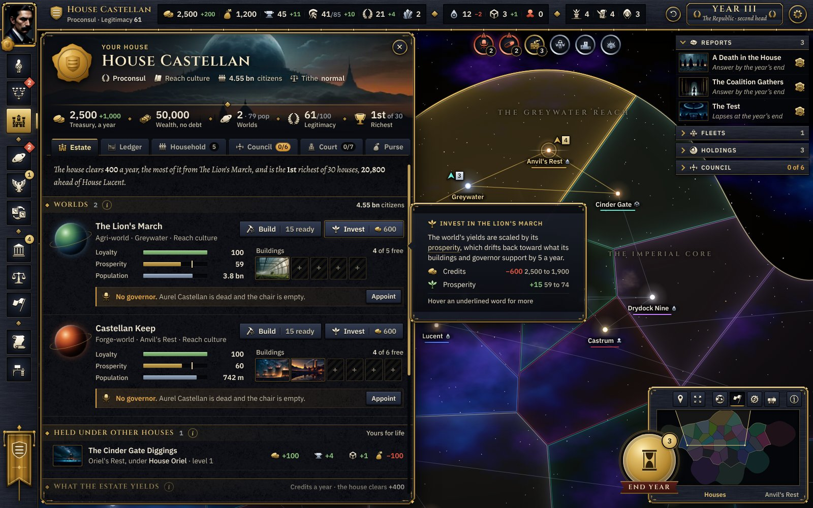
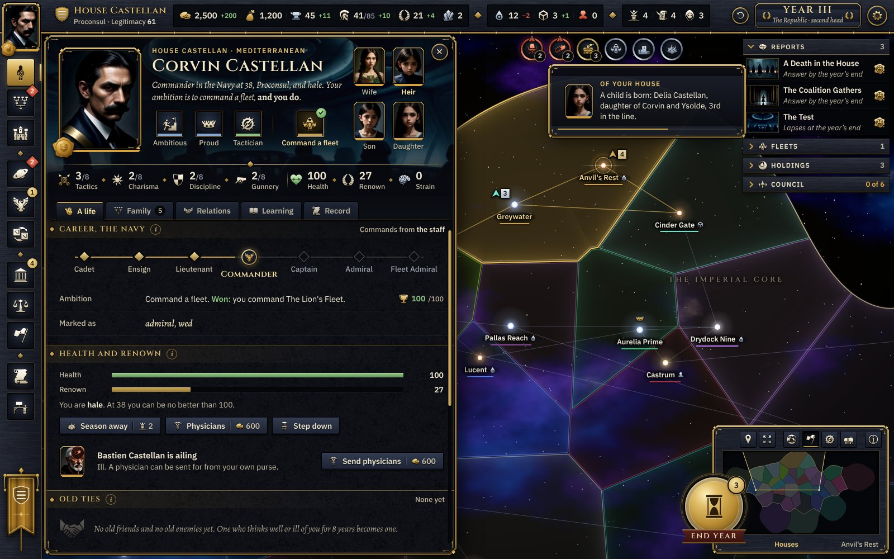
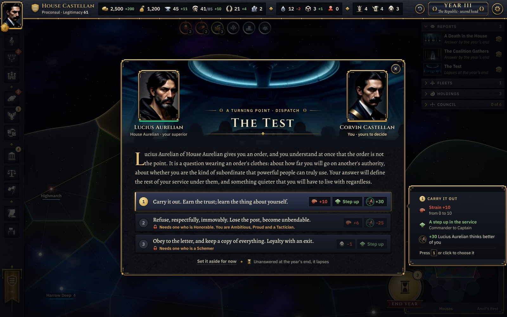
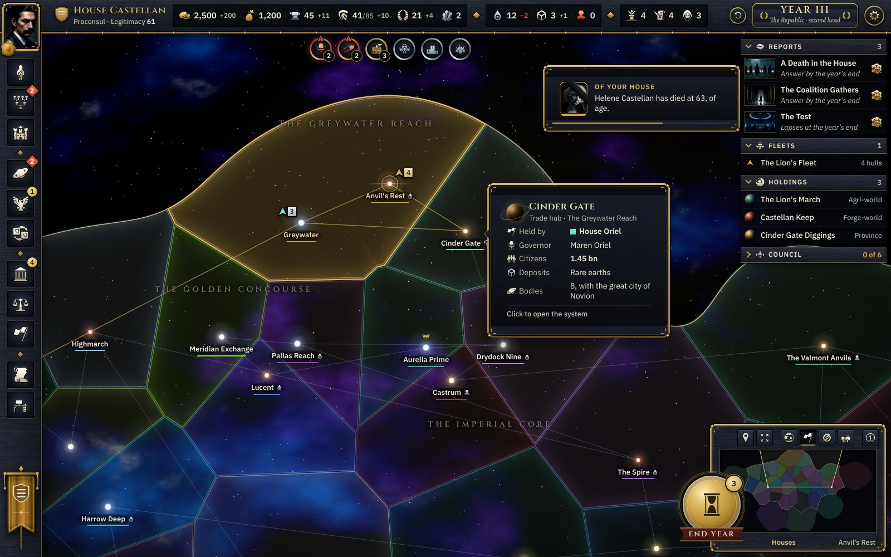
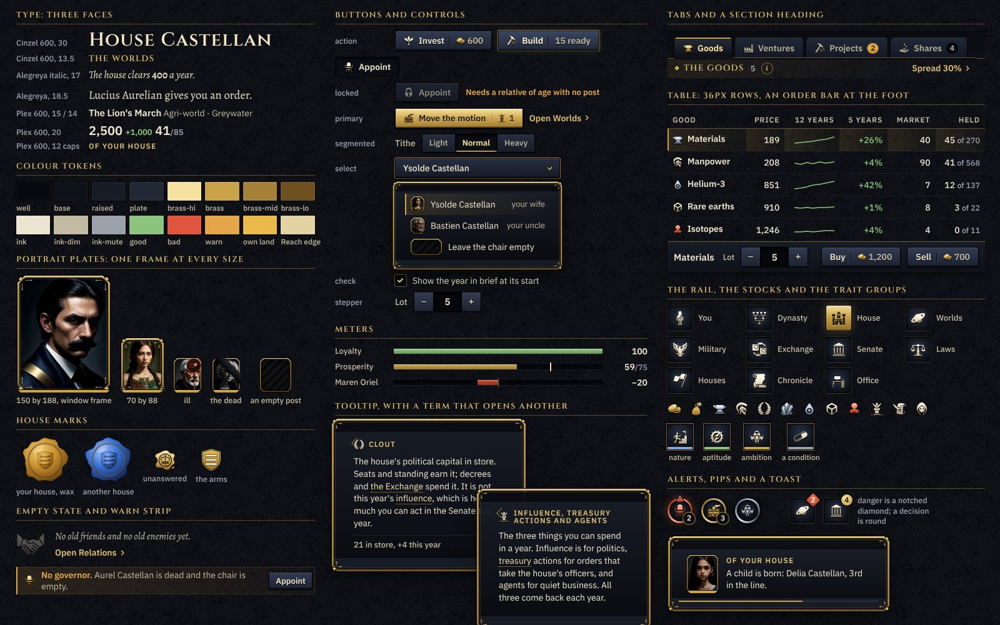

# Praetoria: the visual system the client is rebuilt to

This is the one visual system for the Blazor client in `src/Web`. It is direction A, "Imperial brass", which scored
highest with all three judges (93 against 85.5 and 78), with what the judges took from the other two directions grafted
on and everything they said must be fixed, fixed. The owner's bar: "It has to look like a game you got right off
Steam." Their complaint: "Right now it is very ugly", and before it, too many cards and side panels.

In short: the Paradox look (Imperator: Rome, Crusader Kings III) moved into space. Brushed steel at the edges of the
screen, a leather-dark body inside one chamfered brass frame for every window, a painting at the head of every window,
people shown by their painted faces, the map filling the screen with your own land as the warmest thing on it.

## In the repository

Where the system lives in the client (the foundation, 2026-11-27; the windows and the shell are rebuilt on it one by one):

- **Tokens, the shell and the shared parts**: `src/Web/wwwroot/css/app.css` (section 2's tokens on `:root`, then the old names the
  windows not yet rebuilt still use, pointed at them). Each window's own rules: `src/Web/wwwroot/css/win/<name>.css` (laws, house,
  exchange, you, dynasty, houses, senate, military, worlds, system, event, succession, chronicle, office, creation, academy, map),
  linked from `index.html` after `app.css`, so a window's rule wins over a shared one of the same weight.
- **The shared window parts**: `src/Web/Components/Ui/` (WindowFrame, WindowHeader with its plinth, Tabs, Section, Row and Cell,
  Meter, Plate, Link, Segmented, Select, Check, Stepper, WarnStrip, EmptyState, Globe, Slots, DataTable with its order bar and
  Spark), every class prefixed `ui-`; `Portrait.razor` (the plate of 4.15 by size), `Sigil.razor` (the arms, `Mode="seal"`,
  `Mode="standard"`), `Icon.razor` (`Tone`: brass, ivory, ivory-hi, steel, ember, good, dark). Open the client with `?parts` for
  the sheet of every part, drawn by the real components, to set beside [components.jpg](ui/components.jpg).
- **Icons**: `src/Web/Services/Icons.cs` holds every glyph; `python3 tools/icons.py` writes the sprite and the six ramps into
  `index.html` once, outside Blazor's root, and `tests/IconSpriteTests.cs` fails when the two drift apart.
- **Tooltips**: `js/tips.js` draws the framed tooltip of 4.14. A tooltip's text may open with `[icon] Title — text` for a head
  with its glyph, hold effect lines written `[icon] words = value` (red or green by the sign; `=+` and `=-` say outright that
  it is good or bad for you, `=~` neither) and end with `key: Press [1] ...`.
- **Colour**: `src/Core/Presentation/Palette.cs` (`Player`, the house list of 2.2, `RivalAllowed`), held by `tests/PaletteTests.cs`.
- **Textures and paths**: `--tex-steel` and `--tex-leather` are registered as urls (`@property`), so a window's sheet in
  `css/win/` may use them; any other `url()` written in a window's sheet is relative to `css/win/` (`../../img/...`).
- **Scripts**: WindowFrame's close keeps the class `win-close` and Tabs' buttons carry `data-tab`, so `tools/browser` finds them.
- **What the parts take** (added when the windows were merged, 2026-11-27, from what each window had to build for itself): any
  `data-*` attribute on Link, Section (the band), WarnStrip, DataTable (its wrap, with the order bar), Slots, Stepper (the figure)
  and Plate, and on one tab through `Tabs.Tab(Attrs:)`; `Tabs.Tab(CountTip:)` and `Tabs Sticky StickyTop`; `WindowHeader.Figure`
  with `OnClick` (the figure is a button) and `Attrs`, `WindowHeader Action` (one plate at the top right) and `Strip`/`StripKicker`
  (a person's header collapsing to the 64px strip); `WindowFrame Foot` (the fixed foot with the window's gold plate), `TabRow`
  (named so a Tabs part fits inside it), `BodyClass`, `Bare`, `CloseTip`, `CloseClass`; `Stepper Format` (money through
  `Money.Show`), `Input` and `Live` (a field to type in), `FewerTip`/`MoreTip`; `Slots Items` (built, built with no painting,
  rising, in use, free); `Segmented Refusal` (an option dark, with why) and `Note`; `Plate KeepIcon` (unavailable now, with its own
  glyph) and `Stop`; `Row Wrap` and the `--ui-row-gl`, `--ui-row-gr`, `--ui-row-gap` gutters; `WarnStrip Note` (nothing to do
  here); `Portrait Titled`. The old window rules in `app.css` (every `h3`, `th`, card and `details` of `.game .win-body`) leave
  the section band, the table and everything in a `.ui-wbody` alone, so a window no longer resets them; `.warn` and `.good` weigh
  nothing (`:where`). A plate's corners are cut by its frame and four dark corner cuts, not by a clip-path (a clip-path on every
  plate stopped Chromium's software raster painting a long page).
- **The shell** (step 3, 2026-11-27): `Pages/Index.razor` (the rail with its groups, pips and standard; the docked-window host;
  the console and End Year), `Components/TopBar.razor`, `Outliner.razor`, `AlertsRow.razor`, `Toasts.razor`, `ProfileCard.razor`,
  the boxes (`YearBrief`, `Primer`, `SavesBox`, `SettingsBox` with "Show rail labels", `ConfirmBox`) in `Components/Ui/Box.razor`,
  and the shell's block at the end of `app.css`. Each alert's kind and severity come from `src/Core/Presentation/Alerts.cs`
  (`tests/AlertsTests.cs`). `js/shell.js` tells the map which rectangles the interface covers: the event `praetoria:covered`
  on window, `data-covered="x,y,w,h"` (the docked window) on `.gs-shell.game`, and `praetoriaSpace.cover(rects)` if the map
  offers it; it also works the console's tools and minimap through `praetoriaSpace` without drawing anything.
- **A window in the docked host**: the host (`main.screen.window.docked-win`, `data-screen`) draws the frame, the close roundel
  and one scrolling page (`.win-body`, the brass bar, the fade over the last 56px). A window rebuilt on the parts renders its
  `WindowHeader`, `Tabs` and sections straight inside it, with no `WindowFrame` of its own: the host's old title strip steps aside
  when a `.ui-head` is in the body. To hold the header and tabs still while only the body scrolls, wrap the body in
  `
`. A window that brings its own `WindowFrame` makes the host step aside entirely (CSS `:has`),
  but its close then carries `.win-close`, which the scripts' `closeWindows()` clicks; the host's own close is
  `[data-close-window]`, so the scripts leave docked windows open as before.
- **Sizes**: `python3 tools/rem.py <sheet>` converts px to rem as 2.4 says (media queries, the map's geometry and hairlines stay px).
- **Assets**: `src/Web/wwwroot/img/ui/` (the three frames) and `img/tex/` (the two tiles); credits in `CREDITS.md`.
- `assets/ui.css`, `assets/shell.js` and `tools/` below name the mockups' own reference implementation, which is not in the
  repository; the client's equivalents are the files above.

## 0. The pictures

All are 1600 by 1000 at deviceScaleFactor 1 unless named otherwise, rendered from the HTML beside them
(`node tools/render.js <name>`; `SCALE=2` for the 2x one), kept here as JPEG in [docs/ui/](ui/). Every name, number and sentence comes from a live run of
"The Old Lion" in year 3, read from the build at localhost:8112.

| file | what it shows |
|---|---|
| [house.jpg](ui/house.jpg) | The House window on Estate, docked beside the rail. The Invest button is hovered and its tooltip is open. |
| [house@2x.jpg](ui/house@2x.jpg) | The same page at deviceScaleFactor 2 (3200 by 2000), for judging the finish. |
| [you.jpg](ui/you.jpg) | The You window on "A life", with a news toast. |
| [event.jpg](ui/event.jpg) | The event "The Test" over the dimmed map, choice 1 hovered with its tooltip. |
| [map.jpg](ui/map.jpg) | The map at rest, no window open, a system tooltip on Cinder Gate, a toast for a death. |
| [components.jpg](ui/components.jpg) | The parts sheet: type, colour, buttons in every state, select, checkbox, stepper, meters, nested tooltips, the table with its order bar, portraits at every size, house marks, icons, alerts, pips, toast, warn strip, empty state. |

`assets/ui.css` holds every token and component (sizes in rem on a 15px root), `assets/shell.js` builds the shell
(map overlay, bar, rail, outliner, alerts, console, seals, standard). `tools/` holds the scripts that made the map
(`plate.js`, `mapdata.py`, `terr.py`, `palette.py`), the renderer, the rem converter (`rem.py`), the text-size
check (`larger.js`) and the lint (`lint.js`).

### What changed from direction A, and why

| from | what |
|---|---|
| C | Every window opens on its painting, brightened (brightness 1.16, contrast 1.08), with the shade only behind the text column. Title, facts and a plinth of up to five figures sit on the painting's foot under a gilt rule. House tabs now start at y 272, not 327. |
| C | Alegreya (roman and italic) replaces Cormorant Garamond for every reading role: ledes, event prose, choice labels. Cormorant is gone from the interface. Outliner rows are all Plex, so a list never mixes two faces. |
| C | The event title sits on the painting's foot in Cinzel 600 38px, under the kicker between two laurel sprays, over a gilt rule with a centre diamond. The chevron cartouche is gone. |
| C | A swallow-tailed standard in the house colour with folds, a gilt border and the house's own charge from `Sigil.razor` (Castellan: three bars). A wax seal with the same charge in relief marks the house in window headers and on the ruler's portrait. |
| C | Lit planet globes with a terminator, atmosphere and a thin brass orbit ring. Hatched empty building slots, with "4 of 5 free" matching the slots drawn. |
| C | Laurel sprays on the date plate, the year in Roman numerals there only (YEAR III). Not on End Year, where a wreath reads as cog teeth at 1x. |
| C | Larger outliner report rows (54 by 34 crops of the painting, a one-line italic state, a brass seal while unanswered). With a window open only Reports stays open. |
| C | The parts sheet, rebuilt in these materials (`components.png`). |
| C | Kin plates at 58 by 70 with 13px labels, the heir's label in brass. A toast carries a 52 by 62 portrait and the kicker "Of your house". |
| B | The choice hover tooltip with each effect, its before and after ("from 0 to 10", "Commander to Captain"), and the key. Choice keys are the digits 1 to 9, the keys that pick them. |
| B | The event cast rules: the dead in greyscale with a black ribbon, the decider marked "yours to decide", a quote block for what the game adds (section 6). |
| B | The empty-governor warn strip with Appoint on the strip. A window that does not scroll ends at its content. A scrolling body fades over its last 56px. |
| B | The map at rest with a system tooltip (`map.png`); the minimap caption names the map mode and the system in view; map-mode sockets in the console; no Galaxy button on the rail. The Reach's outer edge is ivory, so brass on the map means only yours. |
| B | Every size in rem, so the client's text-size setting scales the interface. |
| fixes | Holder seams toned (1.3px at 56%, hue at 80% saturation), fills lighter (6% rising to 22%), the camera framed so the empty space past the Reach's edge is under a fifth of the free map, frame metal duller so the bright brass is kept for what is active or yours, the steel tile at half its old amplitude, the leather at 60%, no text under 12px, a readable Military glyph (an eagle), danger shown by shape as well as colour, locked choices at full ink, a flat dim instead of a blur, structured stakes for effect chips, a drop capital that does not split its word, people shown by their faces (Bastien's row), the outliner's report titles in Plex, no pure red and no gold for any rival house. |

## 1. Rules

1. **The map is the screen.** The map always fills the window. The chrome sits at its edges. One window opens at a time,
   docked beside the rail, and the camera keeps your seat in the middle of what is still showing.
2. **One metal.** Brass is the only metal, in every era and register. A dull brass (`#a5813a` family) for frames,
   rules and studs; the bright brass (`--brass-hi`) only for what is selected, active or yours.
3. **Ornament on edges only.** Studs, brackets, rules, diamonds and laurel sit on borders and corners, never behind text.
4. **Red means danger. Gold means yours.** No rival house wears pure red, gold, amber or yellow. Alarm red appears on
   numbers, icons, rims and pips, never on a whole sentence.
5. **Nothing is written over anything.** No map label sits under another label, a star, the window, the outliner, the
   console, the alerts, a toast or a tooltip; one that would is not drawn.
6. **People are faces.** Any row, chip or alert about a person carries their painted portrait.
7. **Every window opens on a painting** chosen by its subject. If the painting would be stretched more than 1.2 times,
   it is framed smaller instead.
8. **Three faces, one each.** Cinzel for titles, Alegreya for reading, IBM Plex Sans for figures and controls.
9. **Plain English, no em dashes** in anything a player reads. Buttons are verbs of one to three words; the
   explanation is in the tooltip.

## 2. Tokens

### 2.1 Colour

| token | hex | use |
|---|---|---|
| `--space` | `#04060b` | behind everything |
| `--well` | `#07090e` | recessed: stock wells, meter tracks, slots, chips |
| `--base` | `#0e1117` | window body, under the leather tile |
| `--raised` | `#171c27` | bands, the order bar |
| `--plate` | `#212836` | buttons and tabs (gradient `#323b50` to `#1c2231`) |
| `--brass-hi` | `#f6e2a0` | active tab text, the year, the active rail socket, selected rows, your own |
| `--brass` | `#c9a24a` | rules, section diamonds, the tab's top line, the scrollbar |
| `--brass-mid` | `#a5813a` | frame metal, hover rings, studs |
| `--brass-lo` | `#6f5020` | shadow side of a bevel |
| `--brass-dk` | `#2b1e09` | glyphs on a brass plate |
| `--brass-ink` | `#dcbd72` | brass used as text: section titles, kickers, links |
| `--steel` | `#8fa3bd` | cold icons (materials, helium-3), information rims |
| `--ink` | `#ece4d0` | body text and figures (14.9:1 on `--base`) |
| `--ink-dim` | `#c3baa4` | subtitles, secondary text (9.8:1) |
| `--ink-mute` | `#9ba1ab` | labels only, never something a player must read to decide (7.3:1) |
| `--good` | `#8cc47e` | a gain, loyalty, health: numbers and icons only |
| `--bad` | `#e0553f` | a loss, an alarm; the only red |
| `--warn` | `#e3a64a` | something waits on a decision: an empty chair, a requirement |
| `--info` | `#7fa8d6` | neutral news |
| `--ember` | `#b8452f` | the rims of danger badges and pips |
| `--house` | `#d4a23e` | the player's house colour by default (portrait bands, the standard, the seal) |
| `--own` | `#e9b949` | your land on the map: fill. Used nowhere in the chrome |
| `--own-line` | `#f0c661` | your land on the map: border |
| `--reach-edge` | `#e3d3a4` | the Reach's outer edge on the map, ivory |

Icon ramps (SVG gradients, defined once): brass `#fbeab4 / #d6ae55 / #8f6a26`, ivory `#fffaf0 / #e2d7bd / #a39780`,
ivory-hi (rail) `#ffffff / #efe6cf / #b8ad95`, steel `#eef4fb / #a9bad0 / #5d6e86`, ember `#ffc3a6 / #ec6c4c / #9b2d1a`,
good `#d8f2c8 / #8cc47e / #43723a`.

### 2.2 House colours

The player's house is gold (`#D4A23E`) unless they choose otherwise in the creator. The other houses take this list in
order (`Presentation.Palette.Houses`), which has no gold, amber, yellow, orange or alarm red, and no ivory (the Reach's
edge is ivory):

`#3A86FF` blue, `#2EC27E` green, `#C9D1DC` silver, `#9B5DE5` violet, `#00D4FF` cyan, `#FF4FA3` magenta, `#A7E34B` lime,
`#14B8A6` teal, `#A3324A` oxblood, `#4C7DFF` cobalt, `#C77DFF` lilac, `#5EEAD4` aqua, `#FF2D95` hot pink, `#1E90FF`
dodger, `#00A86B` jade, `#E7849B` rose, `#8C9BB8` slate, `#8E4C9E` plum, `#5B5FE0` indigo, `#8FE3B0` mint, `#8EC9FF`
sky, `#D36BD8` orchid, `#7CFC00` chartreuse, `#B07CC6` wisteria.

Rule for any colour added later: a rival's hue may not fall between 28 and 70 degrees at saturation above 0.35 (gold
and yellow), and a red (345 to 15 degrees) only at value 0.65 or below (oxblood). Raiders keep their dark red, because
raiders are a danger. Nations beyond the Reach follow the same rule (the Ardent Concord becomes `#9E3350`, the Vashti
Khanates `#7E9C6A`) and are toned harder on the map. Full strength is for small marks (label underlines, portrait
bands, standards); anything larger than about 12px uses a toned version (saturation times 0.8, value times 0.88).

### 2.3 Type

| face | weights | roles |
|---|---|---|
| **Cinzel** | 600 | window titles, names in headers, section titles, the year, the event title, the End Year ribbon, map region names. Never under 13px. Tracking .03 to .04em in mixed case, .1em in capitals, .1em on the event title, .32em on region names. |
| **Alegreya** | 400, 500, 700, italic 400 | the one-line lede of a tab, event prose, choice labels, the person's lede in the You header, italic marks ("admiral, wed"), empty-state lines. Lining figures (`font-variant-numeric: lining-nums`) for numbers in prose. |
| **IBM Plex Sans** | 400, 500, 600, italic 400 | every figure (600, `tabular-nums lining-nums`), labels, tabs, buttons, rows, tooltips, toasts, the outliner. |

The scale, in px at the 15px root and in rem:

| px | rem | use |
|---|---|---|
| 12 | .8 | small-capital labels (.08 to .1em), counts on pips, slot captions; the floor |
| 12.5 | .8333 | figure labels, meter values' small part, captions |
| 13 | .8667 | meter labels, kin labels, the outliner's italic state line, footers |
| 14 | .9333 | body text: row subtitles, tooltips, toasts, warn strips, buttons, tabs; the floor for anything read as text |
| 15 | 1 | row names, stock figures |
| 16.5 to 17 | 1.1 to 1.1333 | ledes (Alegreya italic), world names, the house name in the bar, cast names |
| 18 to 18.5 | 1.2 to 1.2333 | choice labels and event prose (Alegreya) |
| 19 to 20 | 1.2667 to 1.3333 | header figures |
| 30 | 2 | window titles and a person's name |
| 38 | 2.5333 | the event title |

Never more than four words in spaced capitals. Tabs, buttons and kin labels are sentence case.

### 2.4 Units and the text-size setting

The client's text-size setting changes `html` font-size (13.5, 15, 16.5 or 18px, `wwwroot/index.html`). So every type
size, padding, gap and component size is written in rem on a 15px root. These stay in px: hairlines and anything under
3px, borders, shadows, filters, clip-path chamfers, background and mask sizes, the 9-slice frame widths, and the map's
geometry (stars, labels' offsets, the canvas). `tools/rem.py` converts a stylesheet this way and the mock renders are
unchanged by it.

The shell's widths are layout, not text: the docked window is `min(740px, 46vw)` (620px under 1500px wide), the rail
76px, the outliner 262px, the console 318 by 232px. At the "larger" setting (18px root, `tools/larger.js`) the window
content fits but the top bar is 281px too wide: below 1500px, or at the larger setting, the bar folds the pools well
(influence, treasury actions, agents) and the strategic well into one "pools" plate that opens a popover, drops the
yearly changes to the tooltip, and the date plate loses its second line. Tabs drop their icons before they wrap.

### 2.5 Spacing and sizes

A 4px base. Window padding 28px left, 24px right. Top bar 56px plus a 5px brass trim. Rail 76px; sockets 48px, 6px
apart, 9px diamonds between groups. Docked window 740 by full height (from 62 to 994 at 1000 tall). Painted header
200px (288px on You). Plinth 56px. Tab 34px (35 active). Section band 32px. Row 58px minimum with a 54px picture.
Outliner row 32px, report row 48px. Button 32px (28 small). Segmented 28px. Meter 20px high, 8px track. Console 318
by 232px. End Year 104px. Alert badge 40px. Toast 344px wide. Tooltip 300 to 340px wide.

### 2.6 Frames, corners and shadows

- **Window frame** `assets/ui/frame.svg`: a 72px 9-slice used as `border: 24px solid transparent; border-image:
  url(frame.svg) 24 / 24px stretch`. From the outside: 1px black, a 3px bevel of dull brass (`#dcc283`, `#b8923f`,
  `#937230`, `#5e4419` top to bottom), a light hairline at 18%, 1px black, a 1px brass hairline at 30%. Each corner is a
  12px chamfer with a brass diamond stud and two short brackets. The body is cut to the same 14px chamfer with
  `clip-path`. The frame is an overlay layer above the body (a sibling or `::after`), so a scrolling body never clips it
  and the scrollbar never covers it.
- **Medium frame** `frame-md.svg` (48px, slice 16): the console, tooltips, toasts, menus, portraits 64 to 96px.
- **Small frame** `frame-sm.svg` (30px, slice 10): portraits under 64px, the date plate.
- **Corners** are square or chamfered. Only round things are round: medallions, badges, pips, globes, faces in chips.
- **Shadows**: `--sh-drop: 0 10px 28px rgba(0,0,0,.6), 0 2px 6px rgba(0,0,0,.6)` for anything floating;
  `--sh-inset: inset 0 1px 3px rgba(0,0,0,.85), inset 0 0 0 1px rgba(0,0,0,.6), 0 1px 0 rgba(255,255,255,.05)` for
  wells; `--sh-plate: inset 0 1px 0 rgba(255,255,255,.10), inset 0 -2px 0 rgba(0,0,0,.35), 0 1px 2px rgba(0,0,0,.6)`
  for plates. A docked window throws `drop-shadow(8px 0 18px rgba(0,0,0,.65))` on the map.

### 2.7 Textures

Two tiles, both from ambientCG (CC0), made seamless at 512px and tinted:

- `steel-brushed.jpg` (Metal009, high-passed, tinted to `#1b202b` at plus or minus 3 levels; seams measured below the
  row-to-row noise): the top bar, the rail, the console, the outliner's head strips.
- `leather-dark.jpg` (Leather026, tinted to `#0f1117` at plus or minus 2): every window body.

Never under text that has no well or plate of its own. Layers are written with commas, texture last, colour separate:
`background: linear-gradient(...), var(--tex-steel); background-color: #1b202b;`. This is also the fix for today's
flat chrome: `app.css` writes `background: gradient var(--noise)` (two images in one layer) in seven places (lines 76,
106, 125, 461, 803, 866, 871), so the browser drops the whole declaration.

## 3. The shell

### 3.1 Top bar
56px of brushed steel with a light-to-dark gradient, on a 5px brass trim with a rivet every 64px. Left to right:

1. The ruler's portrait (3.2).
2. The house arms at 26px, as `Sigil.razor` draws them; "House Castellan" in Cinzel 17px brass ink; under it "Proconsul
   · Legitimacy 61" in Plex 12.5px.
3. Three recessed wells split by brass diamond studs: the treasury (credits, purse, materials, manpower with its cap as
   `41/85`, clout, exotics), the strategic goods (helium-3, rare earths, isotopes), and the year's pools (influence,
   treasury actions, agents). A stock is a 21px icon, a 15px figure and a 12px coloured change. The breakdown is the
   tooltip.
4. Right: Undo as a 30px roundel; the date plate (192 by 46, small frame, laurel sprays at each end, "YEAR III" in
   Cinzel 17px, "The Republic · second head" in Alegreya italic 13px; click opens the year in brief); one 36px brass
   roundel with a cog for the game menu (Save, Saves, Export, Options, Help, Quit; Esc opens it). No text links.

### 3.2 The ruler's portrait
70 by 88 in the medium frame, standing over the top-left corner of the rail (it fits within the rail's 76px, so it
never covers a window's corner), with a 4px house band at its foot and the house's wax seal (28px) on its lower-left
corner. Click opens the profile.

### 3.3 Rail
76px of opaque brushed steel; its right edge is 1px black, 1px dull brass at 60%, 1px black. Eleven 48px sockets in four
groups split by a brass diamond: You, Dynasty, House / Worlds, Military, Exchange / Senate, Laws, Houses / Chronicle,
Office. A socket is recessed (radial `#222a3b` to `#0b0e15`, inset shadow, a faint brass ring) and holds a 28px glyph
in the bright ivory ramp with a soft light, so it reads at 1x. Hover: a 1px brass ring, and the name shows at once
beside the socket with what waits there ("Senate · 4 waiting"), no delay. Active: a brass plate (`#f3dd9a`, `#c9a24a`,
`#8f6c2a`) with the glyph in `#1d1506` and a 3px brass tab on the window's side. The window's own header kicker repeats
the name. An option in Settings, "Show rail labels", adds 12px labels under the sockets for new players.
A first game shows the labels by themselves for its first three years until the player chooses (docs/WEB_CLIENT.md, "Settings").

**Pips** count what waits: a round brass pip for a decision, a notched ember diamond for danger, so the two differ in
shape and not only in colour. Order of the rail follows `RoleTheme.Priority`; a register changes only the order, the
active glow and the kicker words.

### 3.4 The house's standard
At the foot of the rail, 64 by 150: a vexillum on a crossbar with finials and a cord, swallow-tailed, in the house colour
toned for cloth (folds as vertical light and shade), a gilt border, and the house's own charge from `Sigil.razor`: its
shield outline with the charge in ivory over a darker field (Castellan: three bars). No invented beasts. Click opens
the House window.

### 3.5 Alerts
A row of 40px round badges under the top bar, centred over the free map, never under the window, outliner or console.
A badge is a dark disc holding a 21px icon inside a conic metal rim: ember for danger (with a small triangular "!" notch
on top), brass for a decision, steel for information. Alerts of one kind stack into one badge with a count. The
sentence and its action are in the tooltip; a click goes there; right-click dismisses for the year. Each alert needs a
kind and a severity in the projection.

### 3.6 Toasts
News that needs no answer: a 344px toast in the medium frame under the alerts row, right-aligned to the outliner, with
a 52 by 62 portrait plate (the dead in greyscale with the ribbon) or the event's painting, a small-capital kicker ("Of
your house", "In the Senate") and one sentence. A brass timer line runs along its foot; it fades after six seconds and
the line is kept in the Chronicle under "This year".

### 3.7 Outliner
262px on the right, no slab behind it. Each section is a 28px head strip of brushed steel (a brass chevron that turns
when folded, a 16px icon, Plex 600 12px capitals, the count at the right in warn colour when something is missing) over
rows with their own 80% dark backing. Report rows: a 54 by 34 crop of the event's painting (brightened 1.2), the title
in Plex 600 14px, an italic Plex 13px state line ("Answer by the year's end", "Lapses at the year's end"), and a brass
wax seal while it is unanswered. Fleet rows carry the fleet token, holding rows a small lit globe. Empty sections are
hidden. With a window open only Reports stays open and the rest fold to their heads. It stops above the console.
In a first game the first years' list is pinned above Reports: the same head strip, a row a step with a check well and "Show me",
which lights its control with a pulsing brass ring; with a window open it keeps only the steps left to do, a line each (docs/ACADEMY.md,
"The first years").

### 3.8 Console
318 by 232 in the bottom-right corner: brushed steel inside the medium frame. Along its top a row of 30px tool plates:
your seat and fit the Reach; then the map modes, Realms, Houses, Regions and Supply, as joined sockets (the active one
recessed with a brass foot); then the legend. Under them the minimap (278 by 146, toned territory, the Reach outlined
in ivory, the viewport as a 1px brass outline with a dot at each corner). Under the minimap a caption: the map mode in
brass at the left, the system nearest the centre of the view at the right. Zoom is on the wheel and keys.

### 3.9 End Year
A 104px medallion overlapping the console's lower-left corner: a radial brass face (`#fff0bc`, `#e0bd68`, `#b88b33`,
`#6b4d17`), a 2px black ring, an inner light ring, an engraved outer ring on a dark band, a 44px hourglass in dark
bronze, an oxblood ribbon with "END YEAR" in Cinzel 13px, and the count of unanswered reports on a 28px brass disc on
its rim (brass: a decision, not a danger). Enter opens each unanswered report in turn, then ends the year (docs/WEB_CLIENT.md, "Settings").

### 3.10 By screen width
- 1600 and up: as in the mocks.
- Under 1500px: the window narrows to 620px, the outliner folds to its heads, the bar folds its pools (2.4).
- 1366 by 768: a third of the width or more stays map. The event window keeps every choice on screen: the painting is
  `clamp(150px, 28vh, 352px)` (215px here), so the window is about 620px tall for three two-line choices.
- 1280 by 720, and 125% and 150% OS scaling: checked by `tools/browser` (section 13).

## 4. Window parts

### 4.1 The frame and the body
The window frame (2.6) over a leather body, docked against the rail at x 78. A 30px brass roundel with a drawn X closes
it (top right, 16px in). A window whose body does not scroll ends at its content height, so the map shows below it.
A scrolling body scrolls as one page under a 6px brass scrollbar and fades out over its last 56px
(`mask-image: linear-gradient(#000 calc(100% - 56px), transparent)`).

### 4.2 The painted header
200px (288px for a person). The subject's painting (`img/scenes`, 768 by 352) covers it, brightened
(`filter: brightness(1.16) contrast(1.08) saturate(1.04)`), under a shade that is dark only behind the text column:
`linear-gradient(90deg, rgba(8,10,15,.86) 0%, rgba(8,10,15,.6) 34%, rgba(8,10,15,.08) 62%, rgba(8,10,15,.18))` and a
foot that darkens into the plinth. On it:

- the house's wax seal (82px), or for a screen not about a house, the screen's glyph in a brass medallion;
- the kicker in Plex 600 12.5px capitals, brass ink: the window's name or the subject's relation ("Your house");
- the title in Cinzel 600 30px `#f5e9c9` with an engraved shadow;
- the facts: icon and value pairs in Plex 14px ("Proconsul", "Reach culture", "4.55 bn citizens", "Tithe normal").

Paintings by window: House `world`, You by career (`bridge` for the navy, `court` for law, `senate` for a senator,
`family` for a child), Dynasty `family`, Worlds `world`, Military `bridge` (a battle painting at war), Exchange
`audience` until an Exchange painting exists, Senate `senate`, Laws `court`, Houses `audience`, Chronicle `funeral` in
mourning and `dispatch` otherwise, Office `audience`.

### 4.3 The plinth of figures
56px at the foot of the painting under a gilt rule (fading at both ends, a diamond in its middle). At most five figures
(seven on You), each a 24px icon, the value in Plex 600 20px and a 12.5px label under it, divided by small brass
diamonds. Only numbers; a word such as a party's name goes in the facts or the lede. No bars and no boxes.

### 4.4 Tabs
One row under the painting, at most six; empty tabs are hidden. 34px raised plates (`#1f2635` to `#131823`, chamfered
top corners) in Plex 600 14px sentence case with a 16px icon. A count is a small round badge, gold when it needs
action. The chosen tab takes the body colour, loses its bottom edge, gains a 2px brass top line and brass text, so it
joins the page. Long names are cut to one or two words.

### 4.5 The lede
Each tab opens with one or two lines of Alegreya italic 17px, the tab's summary in a sentence, with numbers in bold
roman lining figures. It is the only prose a tab opens with; rules go in "i" tooltips.

### 4.6 Section heading
A 32px band with a faint brass-tinted light from the left, a 1px brass top line at 50%, a small brass diamond at the
left. The title in Cinzel 600 13.5px capitals at .1em, four words at most, a count beside it, a 17px "i" that opens the
rules as a nested tooltip, and at the right one sum, one note or one link.

### 4.7 Rows
One grid for every list: `54px minmax(0,1fr) auto auto`, at least 58px, a 1px divider at 5% white. A picture (54 by 38
building painting, a globe, or a portrait plate), the name in Plex 600 15px, one subtitle at 14px, figures as icon and
number columns right-aligned, one action at the right. Hover: a brass-tinted plate with a 2px brass bar at the left.
Secondary actions go in the tooltip or a right-click menu. Council posts, court posts, laws, edicts, ventures become
rows, not cards. A row about a person uses their portrait with any condition as a small badge on it.

### 4.8 A world in the estate
A composed entry: a 62px lit globe; the name (Plex 600 17px) and "Agri-world · Greywater · Reach culture"; at the
right Build (with "15 ready") and Invest (with its cost). Under it two columns: three meters (Loyalty, Prosperity with
its target tick, Population written short, "3.8 bn"), and the buildings: a label row ("Buildings", "4 of 5 free") and
the slots, each filled slot the building's painting (64 by 42, name in the tooltip), each free slot a 32px hatched
well with a faint plus. Under both, a warn strip when something is missing.

### 4.9 Warn strip
For one thing that needs doing: a 38px strip with a 2px warn rule at the left and a faint warn wash, an 18px icon, one
sentence ("**No governor.** Aurel Castellan is dead and the chair is empty.") and the action as a small plate at the
right (Appoint).

### 4.10 Meters
One bar: 8px track `#05070a` with an inner shadow; a fill with a lighter 1px top edge
(`linear-gradient(to bottom, color-mix(in srgb, C 55%, white) 0 1px, C 1px, color-mix(in srgb, C 75%, black))`); an
84px label column and a 62px right-aligned value. A target is a 2px bright-brass tick. Variants: diverging (a centre
hairline, the fill from the middle, red to the left and green to the right; an opinion), and signed (the ledger: losses
in ember left of a centre line, gains in brass right of it).

### 4.11 Buttons
- **Action plate**: 32px, `linear-gradient(#323b50, #1c2231)`, 1px black, `--sh-plate`, Plex 600 14px, a 16px icon, a
  verb-first label of one to three words. The cost sits inside at the right after a hairline, as icon and number.
  Hover: a 1px brass ring and a soft brass glow. Pressed: the inset of a well.
- **Primary**: the gold plate (`#f6e2a0`, `#d2ad58`, `#a07a30`) with dark text, one per window at most.
- **Locked**: the plate goes dark and its glyph becomes a padlock; the label stays legible (4.5:1 or better); the
  requirement is written in warn colour beside it where there is room, and always in the tooltip.
- **Small**: 28px, 13px text, for actions inside strips and rows.
- **Segmented**: plates joined with no gaps; the chosen one recessed with brass text and a 2px brass foot.
- **Link** to another window or tab: brass text with a small chevron, never a plate.

### 4.12 Select, checkbox, stepper
`appearance: none` on every native control. A select is a 32px plate with a brass ring and a chevron, and opens a list
in the medium frame; each option can carry a 24 by 28 portrait plate and a dim note ("your wife"); the current one has
a brass bar. A checkbox is an 18px well with a brass check. A quantity is a joined stepper: a minus plate, a recessed
figure, a plus plate.

### 4.13 Tables and the order bar
36px single-line rows, fixed column widths, right-aligned tabular numbers, the first column a glyph and a name in Plex
600. Headers in Plex 600 12px capitals at .08em that never wrap. A 12-year sparkline column (64 by 18, 1.5px line).
The selected row gets a brass bar at the left and a brass wash; its actions dock in one order bar at the table's foot
(name, a stepper for the lot, Buy and Sell plates with their costs) instead of an input in every row. A sentence
repeated down a column becomes a dash with the sentence in the column head's tooltip.

### 4.14 Tooltips
Placed by Floating UI as today. The medium frame with a 6px outset, a dark gradient, a small arrow toward the anchor.
A brass small-capital head with an icon; 14px text; terms that open a nested tooltip underlined with a dotted brass
line; effect lines as icon, words and a value with its before and after ("−600, 2,500 to 1,900"); a footer for keys
("Press 1 or click to choose it"). Nested tooltips open beside the term and overlap their parent.

### 4.15 Portrait plates
One plate at every size: a radial backdrop tinted 32% by the house colour, the painting (`object-position: 50% 22%`),
an inner vignette, a 4px band in the house colour along the foot, and a frame by size: the window frame from 120px, the
medium frame from 64px, the small frame below. A mild unifying grade (`contrast(1.04) saturate(.92) sepia(.06)`).
Sizes: 150 by 188 (profile), 132 by 164 (event cast), 70 by 88 (the ruler), 58 by 70 (kin), 52 by 62 (toast), 46 by
56 (rows), 24 by 28 (menus), 20px round in a chip. Variants: **the dead** (greyscale, a black ribbon across the top
right corner), **an empty post** (a hatched well with the post's glyph at half strength), **a condition** (a 20px badge
at the top right: illness, a wound, prison). No circles and no thin coloured outlines anywhere, the Dynasty tree and
`ProfileCard` included.

### 4.16 House marks
- **The arms**: the shield `Sigil.razor` draws, in the house colour with its charge in ivory and a dark keyline. Used
  at 26px in the bar, in lists of houses and on map tooltips.
- **The wax seal**: an uneven disc of wax in the house colour, a pressed ring, the shield and charge in relief (light
  above, shadow below). In window headers (82px), on the ruler's portrait (28px) and on the profile portrait (40px).
  `Sigil.razor` gains a `Seal` mode.
- **The brass seal** (`lorc/wax-seal` in the brass ramp, 20px): an unanswered report. Never red.
- **The standard** (3.4).

### 4.17 Empty states
A faint glyph (46px at 30%), one line in Alegreya italic 16px, one way on as a link ("Open Relations"). An empty
section folds to that line and loses its heading.

### 4.18 Person parts (You)
- **Trait tiles**: 44px recessed tiles in a dull brass ring with a 4px colour band by group: nature steel blue
  `#7fa8d6`, aptitude green `#8cc47e`, a condition ember; the ambition is a gold tile in a bright ring, with a green
  tick when won. The name under each in Plex 13px; the meaning in the tooltip.
- **Skills** in the plinth: the glyph, the value with its ceiling as a faint "/8", the name.
- **The career ladder**: past ranks as brass diamonds on a brass line, the present rank as a lit medallion with the
  career's glyph and its name in Cinzel, the rest hollow on a faint line.
- **Kin**: four plates beside the portrait in a two-by-two grid, the heir's label in brass.

## 5. The windows

### 5.1 House (`house.png`)
Header: the world painting, the seal, "Your house", House Castellan, its facts; the plinth: treasury and its yearly
take, wealth, worlds and population, legitimacy, rank among the houses. Tabs: Estate, Ledger, Household, Council,
Court, Purse (Ventures moves to the Exchange; Seat and estates into Purse). Estate in this order: the lede; the house's
worlds (4.8); provinces held under other houses (rows with their yields and the dues as a loss); what the estate yields
(the signed ledger).

### 5.2 You (`you.png`)
Header 288px: the portrait (150 by 188) with the seal; the kicker (house and ancestry), the name, a one-line lede that
replaces the old subtitle and lede ("Commander in the Navy at 38, Proconsul, and hale. Your ambition is to command a
fleet, and you do."), the traits and the ambition; the kin to the right; the plinth with four skills and health,
renown and strain. Tabs start at y 362 of 1000, under 45% of the window at 1366 by 768. Tabs: A life, Family,
Relations, Learning, Record. When the body scrolls, the header collapses to a 64px sticky strip (a 40px portrait, the
name, the close).

### 5.3 Every other window
Each takes the same parts: its painting (4.2), its kicker, at most five plinth figures, at most six tabs, a lede per
tab, sections, rows, meters and tables. Dynasty: the tree as portrait plates on brass lines. Senate: the hemicycle
graphic stays, under the painted header. Exchange: the goods table (4.13). Military: fleets as rows with the fleet token
and the admiral's face. Houses: the standings table with each house's arms. Chronicle: the timeline strip, then rows.
Worlds: rows of globes by region. Laws: the estates as diverging meters.

## 6. The event window (`event.png`)

- **Over the map**: a flat dim (`radial-gradient(rgba(3,4,8,.52), rgba(3,4,8,.84))`), no blur; the top bar stays lit.
- **Size**: 900px wide, centred over the free map, as tall as its content; the painting is `clamp(150px, 28vh, 352px)`
  tall, so every choice is on screen at 1366 by 768. Long prose scrolls in its own area; the choices stay pinned.
- **The painting** by subject (`SceneArt.For`; the ship's bridge for an order from a superior), brightened like a
  header, darkening into the body at its foot. The paintings are 768 by 352: at 900px they stretch 1.17 times, which is
  the limit. A repainted event set at 1536 wide is wanted before larger windows.
- **The cast** stand in the painting as 132 by 164 plates in the window frame, the other party at the left, you at the
  right, their names in Cinzel 17px and their relation under them in Plex 13px. Rules: the subject takes the large
  plate; when the subject is dead the plate is greyscale with the black ribbon; when the event is about someone else,
  the player is a smaller plate marked "yours to decide"; when the player is the subject the line reads "You · yours to
  decide" in brass.
- **The head**, centred on the painting's foot: the kicker ("A turning point · Dispatch") in brass small capitals
  between two laurel sprays and two fading rules; the title in Cinzel 600 38px at .1em; a gilt rule with a centre
  diamond.
- **Prose** in Alegreya 18.5px, line height 1.56, `#e8dfc8`, with a two-line drop capital in Cinzel brass set with
  `initial-letter: 2` and a small negative end margin so the first word does not split ("Lucius", not "L ucius"). No
  drop capital for prose under three lines. Text the game adds (what was said over the dead, a letter) goes in a quote
  block: Plex 14px on a darker band with a 2px brass rule at the left and a small-capital head.
- **Choices**: full-width plates, at least 58px: a 28px gold disc with the digit that picks it (1 to 9), the label in
  Alegreya 500 18px, and the effects at the right as chips: a 30px recessed chip with an 18px icon and a signed number
  in Plex 600 14.5px, red or green by whether it is good for you, a person's effect as their face at 22px ringed in
  their house colour. Hover: a brass ring, a lit bar at the left, and the tooltip with every effect in words, its
  before and after, and any requirement against the current stock ("Needs 1,000 credits; the house has 2,500").
- **Locked choices**: the plate darkens, the disc goes grey, the chips drop to half strength, the label stays at full
  ink, and the requirement is a warn line with a lock: "Needs one who is Honorable. You are Ambitious, Proud and a
  Tactician."
- **Set it aside**: a small underlined line under the choices with an hourglass and when it lapses.
- **What this needs from Core**: `ChoiceCard.Stakes` is one string today (`EventWindow.razor` renders it whole). Core
  must expose each choice's stakes as items: kind, icon key, signed amount, before and after where known, person id,
  and requirement. Until then the window shows the string in one plate; the client never parses the text.

## 7. The map

### 7.1 Framing
- Open at distance 1650 (`space.js`; today about 1050), which holds 15 to 22 systems on a 1600 by 1000 screen.
- `camera.setViewOffset` puts the seat in the middle of the free map: between the rail, or the open window, and the
  outliner; re-offset whenever a window opens or closes, and keep the last zoom per save.
- Clamp panning so the empty space past the Reach's edge stays under a fifth of the free map. In `house.png` the seat
  is placed at (1080, 296): the strip of space above the Reach holds the alert badges.

### 7.2 Territory, by zoom (the CK3 method the owner asked for)
Three drawings of the same cells, cross-faded by camera distance:
- **Far**: realms only. The Reach as one pale wash with its ivory edge, each nation in its toned colour with a faint
  hatch, realm names.
- **Middle (the opening zoom)**: houses. As in the mocks:
  - the outer edge of each realm is the threshold of a smooth field (a sum of Gaussians, R 205 world units, threshold
    0.33; the working code is `tools/terr.py`, and B's `map.js` is a JavaScript port to start from), so it is one
    smooth curve with no scallops and no holes;
  - inside, every point belongs to its nearest system, split into crisp holder cells;
  - fills: the holder's toned colour at 6% in the middle rising to 22% over 16px inside its border; nations 5% to 19%
    with a 1px diagonal hatch every 10px at 9%;
  - seams: a 1px dark gap at 50%, then the holder's line at 1.3px, hue at 80% saturation, 56% alpha;
  - region edges inside the Reach: a 1px ivory hairline at 13%;
  - the Reach's outer edge: ivory `#e3d3a4`, 1.5px at 82% over a 1px dark line, with a short inward glow (5px, 10%).
    It is the only line that glows;
  - your land: the brighter gold `--own` at 15% rising to 40%, a 2px `--own-line` border (drawn over the Reach's edge
    where the two meet), and an ivory hairline 4px inside it at 38%. It is the warmest thing on the map.
- **Near**: systems. A faint tint and a fine line round each cell, so the stars and worlds are what is looked at.

Lines are drawn in screen space (fat lines or a distance field in the shader), so they stay 1 to 2px at every zoom and
do not alias under the tilted camera. Borders stay out of the bloom pass. The territory is rasterised into a texture
only when holdings change, never per frame.

### 7.3 Stars, lanes, labels, fleets
- **Stars**: an 8 to 12px core and a 24 to 38px soft halo coloured by class (B `#a9c4ff`, F `#f4f0ff`, G `#ffe1a0`, K
  `#ffb978`, M `#ff9478`). No flare streaks and no orbit rings at galaxy zoom, except a faint streak and a thin gold ring
  on your seat. The capital wears a small crown.
- **Lanes**: 1px hairlines at `rgba(168,188,222,.28)`; lanes that touch your systems in gold at 60%, 1.3px.
- **System labels**: the name only, Plex 600 13px `#ebe6d8` (yours `#f3d68e`), a soft dark backing and a black halo so
  lanes pass under it, a 2px underline in the holder's colour, and a 12px deposit icon after the name.
- **Region names**: Cinzel 600 13 to 15px at .32em, `rgba(238,226,192,.5)`. Placed by a search near the region's centre
  that treats stars, lanes, fleets, other labels and every interface rectangle (window, outliner, console, alerts,
  toasts, tooltips) as obstacles, and drops a name that has no clear place. It runs when the camera stops.
- **Fleets**: a 22px chevron in the owner's colour with a dark outline and a light facet, and a small number plate
  (ivory for yours, steel for others). A fleet only reported is a hollow chevron with "?".

### 7.4 The map at rest (`map.png`)
No window: the outliner shows Reports, Fleets and Holdings; the alerts row and toasts sit in the strip of space above
the Reach. Hovering a system shows its tooltip: a small globe, the name in Cinzel, "Trade hub · The Greywater Reach",
then Held by (the holder's colour square and name), Governor, Citizens, Deposits, Bodies and any great city, and "Click
to open the system".

### 7.5 Minimap
The same territory toned to 38%, borders between owners as dark lines, the Reach's edge in ivory, the viewport in
brass, and the caption under it (3.8).

## 8. Icons

### 8.1 Treatment
Shapes from game-icons.net (CC BY 3.0) plus the game's own marks. One treatment: a gradient fill from one of the six
ramps (2.1), a dark stroke (`#120c04`, 22 units of 512, `paint-order: stroke`) and a 1px drop shadow. On a brass plate a
glyph is solid `#1d1506` with a light 1px shadow. Sizes: 13 to 17px inline, 18 to 22px in chips and stocks, 24px in the
plinth, 28px on the rail, 44px on End Year. The gradients and the `<symbol>` sprite are defined once in `index.html`,
outside Blazor's render tree, so re-renders never duplicate or break them. Every Unicode stand-in (the diamond and dot
bullets, triangles, plus and minus, the multiplication sign on close buttons) is replaced by a drawn glyph.

### 8.2 The rail
| window | icon |
|---|---|
| You | delapouite/roman-toga |
| Dynasty | delapouite/family-tree |
| House | delapouite/castle |
| Worlds | lorc/ringed-planet |
| Military | lorc/eagle-emblem (the aquila; the old roman-shield turned to a patterned tile at 27px) |
| Exchange | lorc/trade |
| Senate | delapouite/greek-temple |
| Laws | lorc/scales |
| Houses | lorc/flying-flag |
| Chronicle | lorc/scroll-unfurled |
| Office | delapouite/desk |

### 8.3 Stocks and figures
| stock | icon | ramp |
|---|---|---|
| Credits | the game's `credits` (Icons.cs) | brass |
| Purse | lorc/swap-bag | brass |
| Materials | the game's `materials` | steel |
| Manpower | the game's `manpower` | ivory |
| Clout | lorc/laurels | ivory |
| Exotics | the game's `exotics` | steel |
| Helium-3 | the game's own drop mark | steel |
| Rare earths | the game's own hexagon mark | ivory |
| Isotopes | the game's own mark | ember |
| Influence (pool) | delapouite/public-speaker | ivory |
| Treasury actions (pool) | delapouite/scroll-quill | ivory |
| Agents (pool) | lorc/cowled | ivory |
| Legitimacy | the game's `legitimacy` | ivory |
| Wealth | delapouite/money-stack | brass |
| Population | the game's `population` | ivory |
| Rank among houses | lorc/trophy | brass |
| Prosperity | lorc/sprout | good |
| Loyalty | delapouite/shaking-hands | good |

### 8.4 Skills (the thirteen in `SkillWords.cs`)
tactics lorc/target-arrows; gunnery lorc/cannon; leadership lorc/rally-the-troops; logistics delapouite/cargo-crate;
discipline lorc/checked-shield; law lorc/scales; oratory delapouite/public-speaker; diplomacy delapouite/shaking-hands;
charisma lorc/sun; intrigue lorc/cowled; administration lorc/tied-scroll; economics delapouite/abacus; engineering
lorc/gears. (Oratory shares influence's glyph and intrigue shares agents', on purpose: they are the same family.)

### 8.5 Traits, by group (`content/traits/traits.json`)
- **Nature** (steel blue band): Ambitious delapouite/stairs-goal, Arrogant delapouite/podium-winner, Cruel
  lorc/bleeding-heart, Honorable lorc/medal, Just lorc/scales, Loyal lorc/crowned-heart, Proud lorc/crown, Ruthless
  lorc/plain-dagger, Vengeful lorc/wolf-head.
- **Aptitude** (green band): Administrator lorc/tied-scroll, Brilliant delapouite/smart, Diplomat lorc/dove, Duelist
  lorc/crossed-sabres, Greedy delapouite/coins-pile, Orator delapouite/public-speaker, Paranoid lorc/spyglass,
  Quartermaster delapouite/cargo-crate, Schemer lorc/cowled, Strategist delapouite/flag-objective, Tactician
  lorc/compass.
- **Ambitions** (gold tile): amass a fortune delapouite/money-stack, command a fleet the game's `fleet`, earn a command
  delapouite/upgrade, master the Senate delapouite/podium, outshine all rivals lorc/trophy, restore the house's fortunes
  delapouite/family-house, seize the throne delapouite/throne-king, win a great love lorc/charm.
- **Conditions** (ember badge on the portrait): ill lorc/pill, wounded lorc/sticking-plaster, in mourning lorc/candle-light.

### 8.6 Everything else
Alerts: no governor delapouite/office-chair, illness lorc/pill, Senate votes delapouite/vote, a foreign fleet
delapouite/spaceship, an office vacant delapouite/podium, the Senate year unspent lorc/sundial. Map tools: your seat
delapouite/position-marker, fit delapouite/expand, Realms lorc/world, Houses lorc/flying-flag, Regions the game's
`region`, Supply delapouite/fuel-tank, legend delapouite/info. Menu lorc/cog, undo delapouite/anticlockwise-rotation,
End Year lorc/hourglass, lock lorc/padlock, unanswered lorc/wax-seal, capital lorc/crown, Build the game's `build`,
Invest lorc/sprout, Appoint delapouite/office-chair, Physicians delapouite/caduceus, Season away lorc/sundial, Step down
delapouite/wooden-chair, a step up in the service delapouite/upgrade, strain lorc/brain, health delapouite/heart-beats,
renown lorc/laurels. Tabs: Estate delapouite/castle, Ledger delapouite/abacus, Household delapouite/three-friends,
Council delapouite/round-table, Court delapouite/throne-king, Purse lorc/swap-bag, A life lorc/heart-organ, Family
delapouite/family-tree, Relations delapouite/shaking-hands, Learning lorc/open-book, Record lorc/scroll-unfurled.

## 9. The Office

The 3D room of untextured shapes (`office.js`) and the cartoon faces drawn by code (`portrait.js` cameos) go now; the
code-drawn faces are not shown anywhere again. The owner chooses between two (docs/GAPS.md, V9):

1. **Recommended: the Office as a painted window.** A docked window built from the shared parts, headed by the audience
   painting (`img/scenes/audience`), with today's visitors standing on the painting's foot as 132 by 164 portrait plates
   (as the event cast) and the year's letters as report rows with brass seals; opening one opens the event window. It
   can be built now with the paintings the game has. Later, one painted set per register (a naval ready room, a
   counting house, a jurist's study) at 1536 wide.
2. **Or drop it**: reports open from the outliner straight into the event window, and the year's dispatches and
   visitors are listed under a "This year" tab in the Chronicle, so nothing is lost. The rail loses its Office socket.

## 10. Other screens, in brief
- **Title screen**: full-bleed key art that is not Earth, a Cinzel logotype with a brass bevel, a short column of menu
  items in Cinzel 20px, scenarios as framed portrait plates with the year in large numerals.
- **Succession**: the funeral painting full-bleed, the old head at 140px in greyscale with the ribbon, the heir at 220px
  in the window frame, "The seat passes" in Cinzel 40px between laurel sprays, what is inherited as an icon row, one gold
  plate.
- **System view and world view**: the standard painted header and plinth; no stretched sprite.
- **The creator**: the same window parts at 1080px, with a house colour picker that offers the house list (2.2) and gold.

## 11. Assets

| asset | source | licence |
|---|---|---|
| Cinzel (500, 600, 700), latin, woff2 | Google Fonts (Natanael Gama) | SIL Open Font License 1.1 |
| Alegreya roman and italic (variable 400 to 900), latin, woff2 | Google Fonts (Huerta Tipográfica) | SIL Open Font License 1.1 |
| IBM Plex Sans (400, 400 italic, 500, 600), latin, woff2 | Google Fonts (IBM) | SIL Open Font License 1.1 |
| Icons by Lorc: ringed-planet, eagle-emblem, trade, scales, flying-flag, scroll-unfurled, swap-bag, laurels, cowled, crown, compass, target-arrows, cannon, brain, heart-organ, open-book, sundial, pill, hourglass, cog, padlock, wax-seal, world, trophy, sprout, sun, checked-shield, gears, tied-scroll, rally-the-troops, crossed-sabres, crowned-heart, bleeding-heart, wolf-head, plain-dagger, dove, spyglass, medal, charm, sticking-plaster, candle-light | game-icons.net (raw SVGs from github.com/game-icons/icons) | CC BY 3.0, credit Lorc |
| Icons by Delapouite: roman-toga, family-tree, castle, greek-temple, desk, stone-bust, public-speaker, scroll-quill, office-chair, vote, spaceship, podium, podium-winner, position-marker, expand, fuel-tank, info, anticlockwise-rotation, money-stack, rolled-cloth, abacus, three-friends, round-table, throne-king, upgrade, stairs-goal, heart-beats, shaking-hands, wooden-chair, caduceus, cargo-crate, smart, coins-pile, flag-objective, family-house, receive-money, factory | game-icons.net | CC BY 3.0, credit Delapouite |
| The game's own icons (credits, materials, manpower, exotics, legitimacy, population, report, fleet, planet, region, build) | `src/Web/Services/Icons.cs`, game-icons.net paths | CC BY 3.0, as in CREDITS.md |
| Helium-3, rare earths and isotopes marks | `src/Web/Services/Icons.cs`, drawn for the game | the project's own |
| Brushed steel tile `tex/steel-brushed.jpg` | ambientCG Metal009 (1K JPG), high-passed, tinted, halved | CC0 1.0 |
| Leather tile `tex/leather-dark.jpg` | ambientCG Leather026 (1K JPG), tinted, softened | CC0 1.0 |
| Frames `ui/frame.svg`, `frame-md.svg`, `frame-sm.svg` | drawn for this design | the project's own |
| Wax seal, arms, standard, laurel sprays, globes, End Year, alert badges, pips, close and check glyphs | drawn in SVG and CSS for this design (`shell.js`, `ui.css`); the laurel sprays are halves of lorc/laurels | the project's own; laurels CC BY 3.0 Lorc |
| Portraits mr11_adult, fr02_adult, fme01_child, mme01_child, fr07_child, mme00_older, mme00_elder, fr07_elder | `src/Web/wwwroot/img/portraits`, picked by the game's own `PortraitLibrary` rule (Bastien and Helene by computing it) | the project's own, AI-generated with Lykon/dreamshaper-8-lcm (CreativeML OpenRAIL-M) |
| Scene paintings world, bridge, court, funeral, dispatch, audience, family, senate, shipyard | `src/Web/wwwroot/img/scenes` | the project's own, AI-generated (as above) |
| Building paintings farm_complex, power_plant, mine, rare_earth_diggings | `src/Web/wwwroot/img/works` | the project's own, AI-generated (as above) |
| Nebula plates `map-plate-win.png`, `map-plate-open.png` | rendered by the game's own `space.js` at localhost:8112 with its objects hidden (`tools/plate.js`) | the project's own |
| Territory, minimap and map data | `tools/terr.py`, `tools/mapdata.py` from the live map model | the project's own |

CREDITS.md gains Alegreya and the ambientCG textures, and loses Cormorant Garamond.

## 12. The build plan

Each step ends with the browser checks of section 13 passing and the screenshots of `tools/browser/windows.js`
looked at.

### Step 1. Tokens, fonts and the stylesheet's foundations
- `src/Web/wwwroot/index.html`: the Google Fonts link becomes Cinzel 600 (and 500, 700 for the logotype),
  Alegreya 400, 500, 700 and italic 400, IBM Plex Sans 400, 400 italic, 500, 600; drop Cormorant. Add one hidden
  `<svg><defs>` with the six icon gradients and the wax gradients, and the icon `<symbol>` sprite, outside the Blazor
  root.
- `src/Web/wwwroot/css/app.css`: replace the token block with section 2's (`:root` from `assets/ui.css`); fix the seven
  comma-less `gradient var(--noise)` declarations; fold every stacked override (`.topbar` and `.game .topbar`, `.rail`
  and `.game .rail`, the three register blocks) into one block each; make the register blocks change only accents
  (the rail's active glow, kicker words, rail order), never the metal or the faces; write every size in rem
  (`tools/rem.py` does it).
- `src/Web/wwwroot/img/ui/frame.svg`, `frame-md.svg`, `frame-sm.svg`; `src/Web/wwwroot/img/tex/steel-brushed.jpg`,
  `leather-dark.jpg` (copy from `assets/`).
- `CREDITS.md`, `docs/ART_DIRECTION.md` (this system replaces "dark glass with light edges").

### Step 2. Icons and the house's marks
- `src/Web/Services/Icons.cs`: add the glyphs of section 8 not yet there; remove fill attributes from paths.
- `src/Web/Components/Icon.razor`: a `Tone` parameter (brass, ivory, ivory-hi, steel, ember, good) rendering
  `<use>` with the gradient fill and the dark stroke.
- `src/Web/Components/Sigil.razor`: keep the shield; add the `Seal` mode (wax in the house colour, the charge in
  relief) and a `Standard` mode (the vexillum).
- `src/Core/Presentation/Palette.cs`: the protagonist's default `#D4A23E`; the house list of 2.2; the colour rule as a
  test in `tests/`.

### Step 3. The shell
- `src/Web/Components/TopBar.razor`: the ruler's portrait with its seal, the arms and name, three stock wells, the
  date plate with laurels and Roman numerals, Undo, the menu roundel with its popover and Esc; the fold under 1500px.
- `src/Web/Pages/Index.razor`: the rail of grouped sockets with pips by shape, instant labels, the standard at its
  foot, no Galaxy socket; the alerts row; the toast host; the console (tools, map modes, minimap and caption, End Year
  with the count); the docked-window host that tells the map which rectangle is covered.
- `src/Web/Components/Outliner.razor`: split into `AlertsRow` and `Toasts` (new components) and the outliner
  sections; report rows with `SceneArt` crops, the state line and the brass seal; folding when a window is open. The
  projection gives each alert a kind and a severity.
- `src/Web/Components/Portrait.razor`, `ProfileCard.razor`: one plate with size tiers, the house band, the dead, the
  empty post and the condition badge.

### Step 4. The shared window parts
- New `src/Web/Components/WindowFrame.razor`: the frame overlay, the body, the close roundel, the scroll fade,
  content height when the body does not scroll.
- New `WindowHeader.razor`: painting by subject (`SceneArt`), shade, seal or medallion, kicker, title, facts, and the
  plinth of figures; the 64px sticky strip on scroll for people.
- New `Tabs.razor` (one row, at most six, counts, empty tabs hidden), `Section.razor` (band, count, i tooltip, right
  slot), `Row.razor`, `Meter.razor` (plain, target, diverging, signed), `Plate.razor` (action, primary, small,
  locked, with cost), `Segmented.razor`, `Select.razor`, `Check.razor`, `Stepper.razor`, `WarnStrip.razor`,
  `EmptyState.razor`, `Globe.razor`, `Slots.razor`, `DataTable.razor` with its order bar.
- `src/Web/wwwroot/js/tips.js`: the framed tooltip, the arrow, the effect lines and the key footer.

### Step 5. Each window
In this order, each moved onto the shared parts with its painting and five figures: `HouseScreen.razor` (and
`HouseholdPanel`, `CouncilPanel`, `CourtPanel`, `WealthPanel`), `CharacterScreen.razor` (and `LifePanel`,
`LearningPanel`, `AmbitionsPanel`), `EventWindow.razor`, `DynastyScreen.razor`, `PlanetsScreen.razor`,
`MilitaryScreen.razor`, `ExchangeScreen.razor` (with `ExchangeVentures`, `ExchangeProjects`, `ExchangeShares`),
`SenateScreen.razor`, `LawsScreen.razor`, `HousesScreen.razor`, `ChronicleScreen.razor`, `SystemPanel.razor`,
`SuccessionInterstitial.razor`, `CreationScreen.razor`, `AcademyScreen.razor`, `SavesBox.razor`, `SettingsBox.razor`
(with "Show rail labels").

For `EventWindow.razor` first: `src/Core/Presentation/CourtProjection.cs` and `ChoiceStakes.cs` expose a choice's
stakes as items (kind, icon key, signed amount, before and after, person id, requirement) beside today's string; the
window draws chips from the items and the hover tooltip from the same items, the cast by the rules of section 6, the
quote block, the digit keys, the lock line and the lapse line.

### Step 6. The map
- `src/Web/wwwroot/js/space.js`: the territory of 7.2 (smooth realm field, nearest-system cells, edge-weighted fills,
  toned seams, ivory Reach edge, gold own land with its inner line), drawn in screen space and out of the bloom pass,
  rasterised only when holdings change, re-tuned (R, threshold) for the small and extra-large galaxies; the three zoom
  tiers cross-faded; stars by class without streaks or orbits at galaxy zoom; name-only labels with underlines and
  deposit icons; the region-label search with the interface rectangles as obstacles; fleet chevrons; the opening
  distance 1650, `setViewOffset` to the free map, panning clamped, the last zoom kept per save; the minimap's look and
  caption.
- `src/Web/Components/GalaxyMap.razor`: the system tooltip of 7.4; the interface rectangles passed to the map.

### Step 7. The Office
- Remove `src/Web/wwwroot/js/office.js` and the cameo faces in `src/Web/wwwroot/js/portrait.js`.
- `src/Web/Components/OfficeScreen.razor`: the painted Office window of section 9, or, if the owner drops it, its
  removal with a "This year" tab in `ChronicleScreen.razor`.

## 13. Checks before calling it done
Added to `tools/browser` and run on every window and tab (`windows.js`), at 1600 by 1000, 1366 by 768 and 1280 by 720,
at 125% and 150% scaling, and at every text-size setting:
1. The computed `backgroundImage` of `.topbar`, `.rail` and every window body is not `none`.
2. No text under 12px; nothing read as text under 14px (`tools/lint.js` is the start of it).
3. No map label overlaps another label, a star or any interface rectangle, with a window open and closed.
4. Every choice of every event is visible without scrolling at 1366 by 768.
5. 9-slice corners meet the clip-path chamfer with no slivers at 1x, 1.25x and 1.5x, in Chromium and Firefox.
6. The tiles show no seam or moire at 125%.
7. Icon gradients and symbols exist once in the document.
8. Every action plate has a tooltip.
9. No rival house colour breaks the rule of 2.2.

## 14. Risks
- The scene paintings are 768 by 352; the event window stretches them 1.17 times, the limit. Larger windows need a
  repainted set at 1536 wide.
- `color-mix()` and `initial-letter` need current browsers; the drop capital falls back to a float.
- Moving alerts into badges needs a kind and a severity on each alert in the projection.
- Six tabs at most forces merges (Ventures to the Exchange, Seat and estates into Purse).
- The register work (the military steel blue) must be undone carefully, so The Old Lion's start is not the least
  finished look.
- Two judges disagreed on the End Year wreath; the laurel stays on the date plate only. The owner may want it back.
- The Office is the owner's decision (section 9).

## 15. What still differs from the spec
The rebuild is merged and every window follows the parts above: the shell, the shared window parts (section 4), the map, the
Office as a painted room, and every tab of You, Dynasty, House, Houses, Exchange, Laws, Senate, Military, Worlds and Chronicle.
All 34 scripts in `tools/browser` drive the new windows. The last critics, at 1600 by 1000 and 1366 by 768 in three starts and
after seven years of play, still saw these, and they are the next to mend:
- **Forms left.** The creator's character section (an input, selects and three walls of text plates where trait tiles belong),
  the Workshop's person, house and family tabs (a label column and controls; the treasury's eight steppers), the Upbringing of
  grown kin (two selects a row), and the Senate's pledge (a select under prose).
- **The Academy.** This term has one short column and empty space beside it; The Reach is a list of labels with boxed chips;
  So far is plain lines; the plinth reads three zeros at the start.
- **The event's outcome.** "What came of it" is a plain box with no painting, and what changed is a line of text rather than the
  chips the choice showed.
- **The map.** Regions mode tints nothing and names no region on the map; at the far zoom a nation's name can sit on a star or
  cross the Reach's edge; in the world view the province plates can overlap one another and the system's name; the End Year
  medallion covers about a third of the minimap, nearer half at 1366 by 768.
- **Long tabs.** Worlds scrolls about five screens after seven years, the House Ledger two, a house's page on Houses two; the
  Senate's motions are tall rows whose names can end in an ellipsis.
- **Caps.** Some section titles and kickers of more than four words are set in capitals ("The dead, and what they left",
  "Military · Navy of House Castellan"); the spec keeps capitals to four words.
- **Sound.** There is none in the game; the settings say so.
